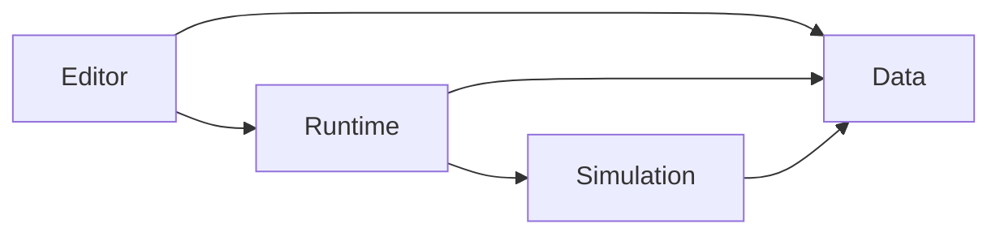

# 代码结构与维护入口

项目代码集中在 `Assets/_Project/`。当前保留 Data、Simulation、Runtime 三个运行时程序集，Editor 使用 Unity 的编辑器程序集；运行时按厨房业务职责分目录，类名和序列化 GUID 保持稳定。

## 职责与依赖

| 位置 | 职责 | 主要入口 |
| --- | --- | --- |
| `Scripts/Data/` | benchmark、语义角色、参数登记、手部/水体配置、匿名反馈 schema | `BenchmarkRegistry`、`ModelAssumptions`、`SessionRecord` |
| `Scripts/Simulation/` | 不引用 UnityEngine 的状态机、动作链和数学算法 | `SessionStateMachine`、`ChallengeTaskTracker`、`MotionKinematics`、`WaterVolume`、`CylindricalLiquid`、`CookingProgress`、`EggBatch`、`TomatoEggRecipe` |
| `Scripts/Runtime/Core/` | 主旅程接线、运行时方案切换与实际任务证据 | `JourneyRuntimeHost`、`RuntimeBenchmarkAdapter`、`TaskEvidenceBridge` |
| `Scripts/Runtime/Feedback/`、`Storage/`、`UI/` | 正式反馈、匿名 CSV 写盘与世界空间引导/比较/恢复界面 | `FeedbackPortAdapter`、`LocalCsvStorageAdapter`、`JourneyWorldSpaceView` |
| `Scripts/Runtime/Debug/` | 联调用替身和调试视图，保留测试用途 | `MockFeedbackAdapter`、`MockStorageAdapter`、`JourneyDebugUI` |
| `Scripts/Runtime/Review/` | 场景语义标记、冰箱方案槽位、世界空间菜单 | `ReviewElement`、`BenchmarkSlotMarker`、`KitchenMenuController` |
| `Scripts/Runtime/Interaction/` | 门/抽屉开合、手部呈现、手掌接触与持物防穿透 | `KinematicSwingDoor`、`KinematicLinearDrawer`、`ControllerHandPresentation`、`CollisionConstrainedGrabTransformer` |
| `Scripts/Runtime/Water/` | 龙头、液体容器、水量流转及视觉表现 | `WaterTap`、`LiquidContainer`、`KitchenWaterSystem`、`LiquidStream`、`LiquidSurface` |
| `Scripts/Runtime/Cooking/` | 独立烹饪样例的储物、切配承载、打蛋、搅拌、受热、翻炒、提示与重置 | `KitchenFridge`、`KitchenStoredIngredient`、`KitchenFoodVessel`、`KitchenEgg`、`KitchenStirTool`、`KitchenPrepTray`、`KitchenPanContents`、`KitchenSpatula`、`KitchenRecipeController`、`KitchenCookingStation` |
| `Editor/` | 创建/适配项目资产，检查编辑状态，保存场景或 Prefab | 下表中的作者工具 |
| `Tests/EditMode/`、`Tests/PlayMode/` | 纯逻辑、资源完整性、物理查询和真实 XRI 流程验证 | 各模块同名测试 |

箭头表示代码引用：

Simulation 可以使用 Data 的枚举/记录，但不使用 ScriptableObject 或其他 Unity 对象。Editor 创建资产，Runtime 消费已经保存的配置和 Prefab。

## 需要修改时从哪里开始

| 任务 | 入口 | 作用范围 |
| --- | --- | --- |
| 正式切换 B1/B2 | `JourneyRuntimeHost` 的 Show/Start 命令与 `RuntimeBenchmarkAdapter` | 复用主线的任务计划、稳定 ID 和反馈/保存状态；只替换方案实例 |
| 原有制作菜单 | `KitchenBenchmarkMenu`，`XR Apartment/Benchmark/Apply …` | 静态预览入口；含 Core 的评审场景须遵守旅程状态，不直接替换任务冰箱 |
| 调整抓取、防穿透、释放速度 | `KitchenGrabAuthoring.ConfigureProp` 与 `SET_HandInteraction` | 一处维护动态接触点、碰撞体列表、扫掠、平滑及释放配置；食品和水容器都调用它 |
| 调整食品和餐具 | `KitchenPropsAuthoring`，`XR Apartment/Props/Configure Kitchen Dressing` | 精选模型、材质、归一化尺寸与公共布置；重建会恢复默认摆放 |
| 调整容器/水站 | `KitchenWaterAuthoring`，`XR Apartment/Water/Configure Kitchen Water` | 水材质、锅杯、龙头和接水盆；重建会恢复登记的水体默认配置 |
| 修改容器网格算法 | `WaterVesselMeshBuilder` | 只构造 Mesh，资产保存仍由水体工具负责 |
| 应用固定天空 | `KitchenLightingAuthoring`，`XR Apartment/Lighting/Apply AllSky Free Daylight` | 天空材质与场景天光；修改后按光照文档重烘焙 |
| 初始化 XR | `XRApartment.EditorTools.XRProjectBootstrap.Configure` | Standalone OpenXR、New Input System 与项目目录；保留已有 Loader，不切平台、不重设 Android |
| 调整反馈必填规则 | `BenchmarkFeedback.MissingRequiredFields` | `HasAllRequiredFields` 和会话完整性复用同一规则；Skipped/Aborted 需要原因 |
| 导入生成物品及预碎 / 预切变体 | `KitchenPreparedAssetImporter`、`KitchenSpecialAssetImporter`、`PreparedKitchenProp`、`PreparedKitchenKnife` | Comfy / Blender 资产扩展；独立制作 Prefab，不写主评审场景；输入和限制见 `KitchenAssetPipeline.md` |

烹饪入口为 `KitchenCookingAuthoring` 和 `SCN_Kitchen_Cooking`，不向正式动作链发送事件。其 partial 文件 `KitchenRecipeAuthoring` 管理菜谱专用模型、Prefab 和接线；`KitchenRecipeStage` 定义食材形态与动作枚举，纯逻辑 `TomatoEggRecipe` 保存实际动作证据，`KitchenRecipeController` 读取交互与烹饪状态。`EggBatch` 复用有限体积数学，水与蛋液的运行时登记分开；曲面显示复用 `LiquidSurface`。身体动作样例为 `CharacterMotionPreview`，柜门继续复用 `KinematicSwingDoor`，菜谱冰箱额外启用固定铰链旋转扫掠。最新回归 EditMode 145/145、PlayMode 49/49 通过，完整开冰箱至成菜检查见 [TomatoEggRecipe.md](TomatoEggRecipe.md)，资产来源见 [KitchenAssetPipeline.md](KitchenAssetPipeline.md)。

`KitchenFoodVisualAuthoring` 是同一制作类的另一个 partial 文件，负责新生成番茄切面 / 小块和熟蛋 PBR、双精度模型的导入与引用检查。它只更新美术，沿用原交互 / 碰撞代理；`KitchenPanContents` 缓存并同步两档蛋块渲染器的熟化和烧焦颜色。当前美术与来源见 [FoodVisualUpgrade.md](FoodVisualUpgrade.md)。

`KitchenCookwareAuthoring` 管理厨房内布置所需的生成厨具 / 冰箱门、陶瓷碗和水站专用副本，仍是同一制作类的 partial。`KitchenBurnerFlame` 只负责火焰开关，`KitchenHeatSource` 将它与实际食物蒸汽、加热分开控制；运行时没有增加全局服务或新程序集。布局、来源及操作见 [KitchenRoomAndCookware.md](KitchenRoomAndCookware.md)。

驱动手柄位置的测试须先经过一个渲染更新，再等待物理步。`CollisionConstrainedGrabTransformer` 按 XRI 的 Dynamic / OnBeforeRender 阶段消费追踪姿态；只等待连续 FixedUpdate 会在慢帧追赶时跳过输入样本。两项旧抓取测试已用强制物理追赶复现并修正驱动时序，未放宽断言或改变运行时约束。

`KitchenAuthoring` 集中公共资产路径、必需资源加载、编辑状态/场景检查和 Prefab 的加载—修改—保存—释放流程。不要在单个作者工具里重复这些规则。Prefab 修改失败也必须释放其编辑内容；保持 `.meta` 与资源一起移动。

## 保留的具体模块

- 门体和抽屉共享 `MotionKinematics`，各自保留小型运动适配；禁用时只移除自己的监听，不清除其他模块的监听。
- `KinematicPalmSolver` 处理静态表面的手掌球，`HeldPropSweep` 处理整个持物的平移与旋转。两者碰撞规则不同，分别维护。
- `ReviewElement`、`BenchmarkSlotMarker` 是场景语义入口；状态机和反馈 schema 仍有 PRD 职责，不能按“当前未接 UI”删除。
- 手部/水体参数来自登记表；不把几何尺寸分散回运行时脚本。当前正式旅程为 B1/B2，共用动作链、交互约束与环境；B3 的代理资源保留，不自动进入主线的 P0 会话计划。

## 验证与范围

保持 Unity 2022.3.62f3 / Built-in / Linear / XRI 3.5 / StandaloneWindows64；不修改 Samples、来源美术、场景摆放或烘焙。

本次整理验证（2026-10-16）：

- EditMode 77/77、PlayMode 8/8 通过，包含原防穿透回归、未完成任务的原因校验，以及门/抽屉反复禁用启用后的监听保留。
- 35 个原项目脚本的 GUID 全部保留，其中 19 个移动目录。场景、其他 Prefab、烘焙及工程/包设置与整理前一致；水站 Prefab 只删除未读取的 `profile` 字段。
- 作者工具：重复配置抓取保持一个扫掠代理，编辑失败后释放 Prefab 内容，三个场景作者入口拦截错误场景；锅、杯、接水盆生成的顶点/三角形/法线与原网格一致。
- 场景组件检查：B1/B2 的两扇门、B3 的两扇门和两个抽屉均能开合到底，共用环境/道具/水体/天空引用保持一致。
- XRI 抓取下接水约 204.827mL → 341.378mL；临时容器检查中，杯内约 204.827mL 倒入锅，未计入溢出，体积误差小于 0.001mL。

诊断文件位于忽略入库的 `Logs/CodeCleanup/`。这些编辑器与组件 API 检查不代表完整需求验收；Quest Link 手感与头显性能仍按 PRD 单独验证。

抓取、水体、美术迁移的详细限制分别见 [HeldPropCollision.md](HeldPropCollision.md)、[KitchenWaterAndSky.md](KitchenWaterAndSky.md)、[MzhKitchenMigration.md](MzhKitchenMigration.md) 和 [KitchenDressing.md](KitchenDressing.md)。

## 与最新 main 的整合

2026-10-27 从 `origin/main@3a5c009` 整合到 `feature/hzc@069aa86` 的工作区。保留主线评审场景、Core/Feedback/UI/Storage 接线与新会话字段；新增四个 UI 作者脚本移入 `_Project/Editor`，保留原 GUID。已有手部、天空、水体、美术和 11 件持物约束继续使用。

主线曾通过 VelocityTracking 改善持物碰撞；本分支继续由 `CollisionConstrainedGrabTransformer` 检查最终抓取姿态。测试验证实际不可穿透与释放后的刚体恢复，不把持物时的刚体模式当作需求。反馈记录采用主线现行契约：跳过须有原因，安全退出是会话 Aborted，不把中止任务算成已完成反馈。

整合验证：EditMode 133/133、PlayMode 28/28 通过，包含主线完整流程、反馈/CSV、已有防穿透回归，以及新增双持物交叉、XRI 取物/重置和编辑器预览状态保护。双持物测试使用实际道具碰撞体，不以刚体模式或碰撞回调次数代替不可穿透结果；取物测试固定非目标物品以单独验证目标的真实 XRI 路径，仍不代表完整人工操作验收。

双手持物时，扫掠前同步 Transform 到物理查询，避免同帧后处理的物体看到先处理物体的旧位置。作者菜单在含 Core 的场景中经 Host 提交 ShowBenchmark；Challenge 内拒绝预览，不销毁当前任务目标。主线场景、Rig、冰箱资产及所有美术保持原引用，未重新烘焙。当前 Mac 只安装 Mac Build Support，Windows Player 与本次整合的 Quest Link 体验仍需在 Windows 侧验证。
