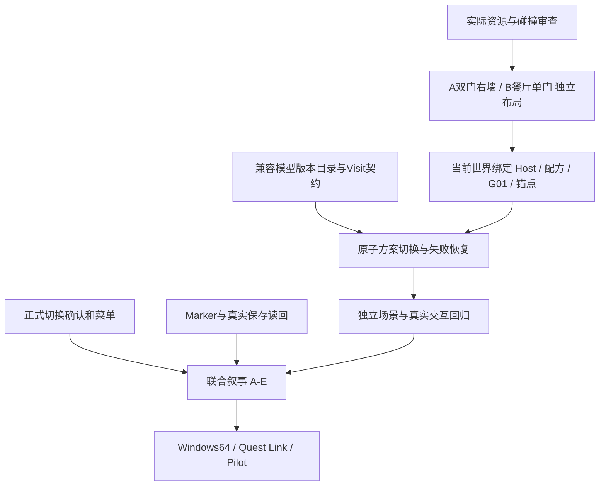

# M2 Narrative Goal Plan

2026-11-16 B冰箱留缝增量：当前A integrated-kitchen-m2-v5、B external-fridge-m2-v8。冰箱仅向水槽横墙靠近10cm，目标净距约7.7cm，105°及碰撞规则保留；其余v7布局保持。实测最小净距0.077018m；Edit35/35、Play24/24、B收纳/完整G02 2/2分批通过，10文件重复作者一致。Windows64构建0错误/0警告及启动冒烟通过，2811保护文件不变，用户未保存B设置保留。T1 Verified — Independent / Ready for Integration，Quest Link仍待验收。见 [B_Fridge_Wall_Gap.md](B_Fridge_Wall_Gap.md)。下文为此前历史。

2026-11-16 B加长板/微波炉/工具布局增量：当前A integrated-kitchen-m2-v5、B external-fridge-m2-v7。悬空板1.56m、左段下方固定微波炉；B工具按A水平布局和朝向同步，因台面低1cm相应下降，B台面形状保留。Edit35/35、Play24/24、完整料理/收纳5/5分批通过，10文件重复作者字节一致；Windows64构建0错误/0警告、默认A启动冒烟通过，2792保护文件不变。B Player交互/Quest Link仍待验收；T1 Verified — Independent / Ready for Integration。见 [B_Extended_Shelf_And_Tools.md](B_Extended_Shelf_And_Tools.md)。下文为此前历史。

2026-11-16 B收纳设计增量：当前A integrated-kitchen-m2-v5、B external-fridge-m2-v6。新增原木四格窗下开放柜、接续台面的暖白细框双门地柜和单层悬空层板；保留冰箱/横墙/门洞。Edit34/34、兼容Play23/23（含新交互5项）及10文件重复作者字节一致已通过；料理/收纳首批4/5，B完整G02相同源码单项复测1/1，保留切菜物理批量波动。Windows64构建0错误/0警告、启动冒烟通过；3726保护文件不变，用户Editor未保存B起始保留。T1 Verified — Independent / Ready for Integration，Quest Link及正式联合仍待验收。接入、参数、失败和实际截图见 [B_Storage_And_Prep.md](B_Storage_And_Prep.md)。下文为此前版本历史。

2026-11-16 B 北移增量：当前 A **integrated-kitchen-m2-v5**、B **external-fridge-m2-v5**。B冰箱目标(-4.65,0,-0.20)m，北端铰链靠水槽侧横墙、南端把手，105°目标；门/食材/储物/稳定身份接线保留，新增B专属派生门体网格和可重复作者配置。Edit31/31、Play18/18、完整料理/收纳5/5分批通过；横墙净距实测17.70cm、作者12文件重复字节一致。A-v5/B-v5 Windows64构建及启动冒烟通过（0错误，2条MCP断连警告），3703个受保护文件保持；T1 Verified — Independent / Ready for Integration，正式联合/Quest Link仍待验收。参数、截图与失败记录见 [B_North_Fridge.md](B_North_Fridge.md)。下文为此前版本历史。

2026-11-16 锅灶吸附：A 当前 integrated-kitchen-m2-v5，B 仍 external-fridge-m2-v4；保留 v4 台面/摆位，仅在 A 炒锅实例接入放下固定/抓取解除。自动落位不创建手持选择，不改变 G01/G02 事实/完成语义；Editor 验证与设备缺口见 [A_Pan_Stove_Snap.md](A_Pan_Stove_Snap.md)。

2026-11-16：A 模型更新为 integrated-kitchen-m2-v4：长台左灶右切配、斜边连续台面、锅初始在熄火灶架上；原水槽台及柜墙前后层次保留。沿用 G01/G02 的实际动作与事实/身份契约，未改公共 Cooking 逻辑或 Goal 完成判定。Edit28/28、台面与物理/生命周期/柜门Play14/14、A收纳/A完整G02/原Cooking完整料理3/3分批通过；首批2/3失败、邻片阻挡诊断和A夹具前侧空位修正见 A_Chamfer_Worktop.md。用户已明确方位为面对长台面的左右。当前 Windows/Quest Link/Pilot不因这些Editor结果视作完成。

2026-11-15 增量：方案 A 整合柜体已更新至 v3；六扇可拉柜门、固定微波炉外观、柜体及转角收口支持原收纳/料理体验。新柜体不降低冰箱既有可达角度；左门原厨房门框限位仍保留。柜体/生命周期/切换/冰箱11/11，A两件食材G01/A完整G02/原Cooking完整料理3/3，资源/Core27/27分批通过。范围、尺寸及失败记录见 A_Integrated_Cabinet.md。旧 A-v2/B-v4 Windows 构建是历史证据；当前 v3 尚未重新构建或完成 Quest Link/Pilot。微波炉仍不加热、不开放 G04；T2/T3 正式联合缺口不变。

2026-11-14，Uncommitted。产品依据 Unified Narrative v0.5；本轮完整授权见负责人提供的 T1 Phase 3 Workflow Upgrade, M1 Handoff & M2 Narrative Goal Mode。技术事实以当前代码和实际执行证据为准。

## 用户叙事与 Coverage Matrix

住户可以只进入 A 或 B，从购物袋存放、取材或直接做菜；可中途停下、标记、Review或结束。两方案呈现供建筑师讨论的空间取舍，不预设优劣。切换经用户确认，重新初始化目标世界/Goal，Session和历史反馈保留。回到曾访问方案也加载起始状态。

| Goal / 生活体验 | 当前能力与缺口 | 验收条件 / 证据 | 状态 |
|---|---|---|---|
| M2-G01 两套真实设计 | 唯一主场景A/B完整料理、收纳搬运、开门及几何检查通过；原Cooking回归通过；B已修搁架交叠和窗下开口 | A右墙双门冰箱+整合柜；B餐厅窗边大单门+新增备餐台；当前对象引用正确；资源/空间检查 | Verified — Independent：M2-main-current-playmode.xml 21/21范围；设备空间舒适性未验收 |
| M2-G02 主动可靠切换 | 真实A→B→A、占用失败/重试和Reset通过；Core验证保存前置/旧回执/并发拒绝；持物失败和异步保存期间选择保持已通过 | 只成功切换更新Scheme/Visit/Model，失败保留旧世界；Review不重置；T2确认说明 | Ready for Integration：T1独立验证；正式确认Integration Pending |
| M2-G03 准确空间上下文 | 每案独立版本/目录、不可变快照/事实和Visit过滤已验证；当前Resolve绑定当前世界 | 旧事实不改新Goal；捕捉上下文不被覆盖；历史位置保留由T3接入 | Ready for Integration：T1独立验证通过；正式Marker/历史Integration Pending |
| M2-G04 双方案与设备准备 | 主场景综合21/21；持物修复17/17；实际G01完成2/2；最终HDRP修订EditMode26/26、PlayMode6/6分批通过；A-v2/B-v4 Windows64构建及启动冒烟完成 | 当前源码引用/回归；真实Windows64产物；Quest Link与约20分钟Pilot路径 | T1 Ready for Integration；Player完整交互、Quest Link/Pilot Device Pending，正式联合Integration Pending |

## 实施前只读审查

1. 可复用 V2 主场景的唯一Host、XR Rig、环境/餐桌/水站/工作台和M1同对象购物食材；旧Cooking的抓取、配方及重置已验证，但共享源修改会影响旧场景。
2. `SCHEME_A/B` 目前仅在ReviewContracts中定义；现有 F2/F3/F4 为Phase 2单点代理，不能认定为完整可Cooking的A/B。Cooking冰箱是大型单门，有储物/取材门控。
3. Layout Lab有目的地占用检查、Fridge切换和UseFridge引用重接可参考；其局部冰箱/面板变换与ResetStation不能充当整厨切换。
4. 工作台、环境、餐桌、水站和Rig等15个共享Prefab会传入旧Cooking；采用V2专属资源/实例接线，避免直接改共享源。
5. V2目前引用Cooking的LightingData/Settings；A/B几何变更需独立光照策略及实测，旧烘焙不支持新布局正确性声明。方案碰撞/身份必须随当前完整世界一起切换，不混合A/B。
6. G01需要当前fridge及储物Zone，G02需要当前recipe/station；Host/Bridge/门控/Reset绑定必须一起更新。模型版本与Goal可用性独立。
7. T1负责独立布局、Core端口、身份和接线/回归；T2负责正式确认与菜单；T3负责Marker、保存/历史；设备与Pilot需T4/T5协作。

精确房间/碰撞坐标由只读 `ReviewV2SchemeInspection.Run` 导出到忽略的 Logs/ReviewV2/M2/scene-inspection.txt 后确定，不能从文档猜测空间可用性。

新增原型布局参数登记在 `Layout_Assumptions.tsv`，与每案ModelVersion共同追溯。尺寸/位置仅是代表性模型的制作假设，不作客户事实、净空合规或舒适性结论。A/B已接唯一V2主场景；隔离制作阶段的审查和失败作为历史保留。完整产品范围的联合/设备验收仍未完成。

## 依赖关系

## 验收路径

A和B各自：Setup/教学→自由存放或直接Cooking→半途可Review→返回世界保持；也允许零Goal结束。A→B确认后新Visit、B初始World/Goal；B事件仅属B；再回A初始世界。失败切换不改变原世界/Goal/身份。正式Marker历史/保存失败读回待T3联合测试。设备路径涵盖开门站位、抓取搬运、餐厨传送和菜单可读性，不从Editor推断舒适性或设计优劣。
