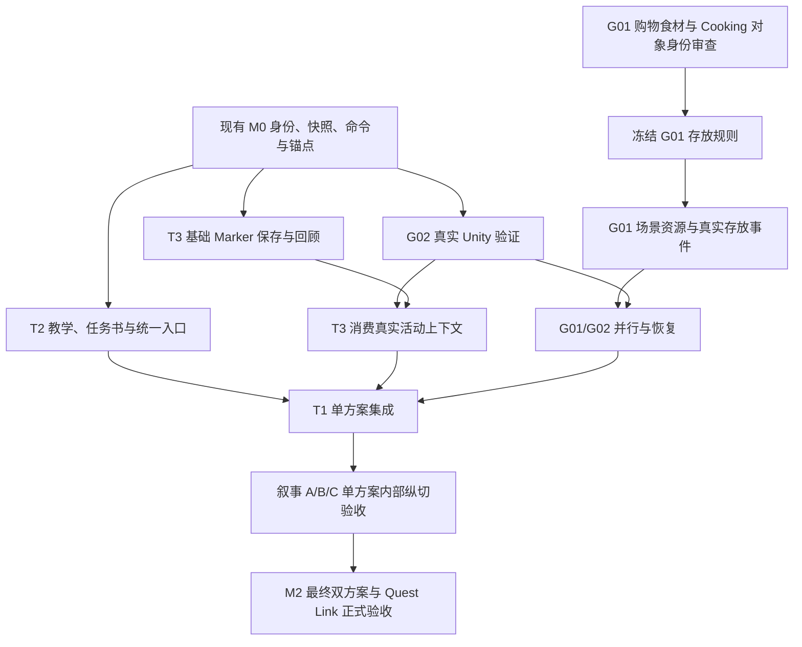

# M1 单方案叙事与验收计划

日期：2026-11-14。依据 Unified Narrative v0.5 与负责人审核意见。最初仅批准 G02 验证；后续目标附件第 5 节已授权可逆 V2 专属实现/测试自主推进，高影响改动仍须审批。G01 已完成对象身份审查并制作同对象原型；负责人另行批准 V2 配方排除开冰箱前置及双场景回归。当前真实状态以 `M1/T1_Development_Progress.md` 为准，不把旧的逐项暂停规则继续作为低风险工作阻塞。

## 产品证据与技术证据

每项交付须回答：它让住户获得哪种真实空间体验，或让哪种观察更准确地交给设计师？目标状态、计数和事件只能证明技术行为，不能单独证明设计沟通有效。不能从未完成活动推断布局存在问题。

G02 的技术价值是识别真实料理加工，使半途 Review 和反馈上下文能区分“已经在操作工作台”与“只抓过物体”。住户实际获得的空间体验来自现有取材、切配和厨具操作。只有 T3 将事实与位置、标记及住户自己的解释关联后，设计师才获得可追溯观察；G02 检测本身不构成产品闭环。

## 依赖与并行工作

T3 不等待 G01：可以先基于 COOKING_STATION、FRIDGE 及现有稳定对象 ID/Resolve 接口完成空间捕捉、即时保存、零标记回顾与读回。不存在的 Anchor 不得猜测；支持已有对象锚点和明确的场景位置后备。G01 新 Zone/Anchor 作为后续增量，不阻塞基础反馈闭环。

## 实施顺序与审核关卡

1. 本轮：恢复验证进程的缓存/临时空间，编译当前源码，运行 V2 EditMode/PlayMode。检查真实 G02 开始、Ready 完成、Review 往返、Reset、新 Visit、事实去重与 Phase 隔离。测试夹具的直接组件调用与完整控制器操作证据须分别描述。
2. 并行交付：T2 提供正式入口与提示；T3 基于现有身份完成基础 Marker、回顾、真实保存/读回及失败重试。T1 仅接线、维护身份与端口，不接管业务。
3. G01 先审查对象身份：明确购物包中的番茄/鸡蛋是否为配方引用的同一实例；若为新增实例，说明 Cooking 如何识别和使用。检查现有取材证据与初始冰箱库存假设，保证先做饭无需先收纳。此决定后才冻结合格食材、最低件数、有效 Zone、释放/稳定判定、去重与取出后的状态规则。
4. 按新风险分级实现 G01，优先 V2 专属资源与实例接线。共享 Prefab/Cooking 核心行为改动须先报告审批，并验证原 Cooking 场景；本次开冰箱配方条件已获明确批准。G01 的数量/Zone/稳定参数为可调原型假设，不当作已冻结的研究结论。
5. T1 将 T2/T3 交付接入 V2，T4 按下列叙事路径验收。不能按已完成多少功能替代端到端行为。

## 端到端验收对象

| 路径 | 住户行为与预期证据 |
|---|---|
| Narrative Goal A | 先开始 Cooking，再收纳：G02 与 G01 可独立进行；后开始活动不重置先前世界；用户可在实际位置留下自己的空间观察，保存与读回关联正确。 |
| Narrative Goal B | 料理中途标记、Review、返回：食材、锅、水与 Goal 保持；回顾能定位标记及原活动上下文，补充说明可空。 |
| Narrative Goal C | 零完成目标、零或多条标记：自主进入 Review；实际保存并读回后结束；失败可重试且不显示成功。 |
| 恢复分支 | Pause/Resume 保持世界；显式 Reset 新建 Visit 并清目标，历史反馈保留；程序恢复不伪装成用户事实。 |

## 验收层级

COOKING_BASELINE 是现有代表性厨房的技术与内部体验基线，不能改名或直接宣称为最终 SCHEME_A/SCHEME_B。M1 内部纵切验证单方案真实活动、反馈与恢复的一致性；它不证明最终方案的空间取舍、双方案比较或正式设备体验有效。

M2 才接最终 A/B 模型、模型版本、跨方案世界策略和历史反馈归属，并完成双方案及 Quest Link 正式端到端验收。M1 的 Editor/桌面测试不能替代 M2 设备验收；提前进行设备冒烟也必须标明实际模型和范围。

## 文件与风险边界

G02 预计涉及 ReviewContracts、CookingPreparationEvidence、ReviewSessionHost、KitchenRecipeController 的只读切分计数、V2 定向测试与契约文档。G01 预计新增专属资源/检测组件，并修改 V2 场景、身份目录、可用性和测试；准确清单在对象身份审查后冻结。

V2 与 Cooking 共用工作台及其他 Prefab，且当前沿用 Cooking 烘焙数据。修改共享资源须双场景回归；修改静态几何/灯光须另存 V2 烘焙。不得用整场景 Rebase 覆盖跨角色接线。正式保存端口尚未接入时的 M0 NotConfigured Finish，不算 M1 的可靠保存验收。
